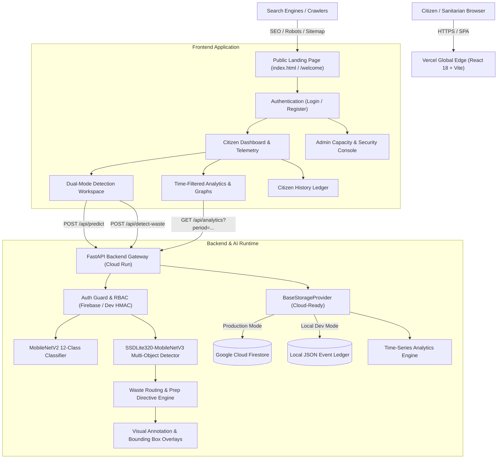

# SMART-ECO-BIN
## SMART ECO BIN / EcoSort AI
## Intelligent Multi-Object Waste Segregation & Municipal Sanitation Intelligence Platform

[](https://github.com/mohanreddyn18/SMART-ECO-BIN/actions/workflows/ci.yml)
[](ml/)
[](LICENSE)

> **Deployment status:** This workspace has not been deployed or connected to a verified production API. The previously listed Vercel URL does not serve this project.  
> **GitHub Repository:** [https://github.com/mohanreddyn18/SMART-ECO-BIN](https://github.com/mohanreddyn18/SMART-ECO-BIN)

> **Current local model status:** The classifier checkpoint matches the validated committed model and both the classifier and detector loaded successfully in the local backend environment. Real-world waste-photo accuracy has not been independently evaluated. See [SETUP_GUIDE.md](SETUP_GUIDE.md) and [TESTING.md](TESTING.md).

EcoSort AI is a waste-segregation web application with two computer-vision workflows:
1. **Single-Item Classifier:** PyTorch `MobileNetV2` intended to classify 12 municipal waste categories. Reported benchmark accuracy is not independently reproduced here; predictions require a valid checkpoint.
2. **Mixed-Waste Multi-Object Detector:** PyTorch/TorchVision `SSDLite320-MobileNetV3` detector that can return object labels, bounding boxes, and confidence scores, with per-object disposal guidance. The underlying detector is a generic COCO model, not a validated waste-specific model.
3. **Longitudinal Telemetry & Analytics:** Supports Google Cloud Firestore when configured, or a local JSON ledger in development, with 7-period time filtering and baseline comparisons.

---

## Architecture Diagram



---

## Repository Structure

```
SMART-ECO-BIN/
├── frontend/                     # React 18 + Vite SPA (Vercel-ready)
│   ├── public/                   # SEO assets: robots.txt, sitemap.xml, favicon.svg
│   ├── src/pages/public/         # Public discovery LandingPage.jsx (accessible without auth)
│   ├── src/pages/user/           # Citizen dashboard, waste detection, analytics, history
│   ├── src/pages/admin/          # Role-guarded municipal administrator portals
│   ├── src/services/api.js       # Centralized API client (supports VITE_API_BASE_URL)
│   └── vercel.json               # SPA route fallback rewrites & security headers
├── backend/                      # FastAPI Python gateway (Cloud Run-ready)
│   ├── app/auth/                 # Cryptographic token verification & RBAC
│   ├── app/routes/               # REST endpoints (/api/detect-waste, /api/predict, /api/analytics)
│   ├── app/services/             # Model loading, detector service, waste routing engine, analytics
│   └── Dockerfile                # Single-worker, non-root PyTorch CPU container
├── ml/
│   ├── model/waste_model.pth     # Validated MobileNetV2 12-class classifier checkpoint
│   ├── model/waste_detector.pt   # 13.5 MB SSDLite320-MobileNetV3 multi-object detector
│   ├── metadata/                 # Class mappings & performance benchmarks
│   └── train_waste_detector.py   # Dataset validation, TACO converter, and export pipeline
├── tests/                        # unittest regression and integration tests
├── .github/workflows/ci.yml      # GitHub Actions CI/CD with security scanning & deployment gates
├── cloudbuild.yaml               # Google Cloud Build automation specification
├── requirements.txt              # Root dependency redirect
└── PROJECT_STATUS.md             # Comprehensive project lifecycle log
```

---

## AI Capabilities & Limitations

### 1. Single-Item Classifier (`MobileNetV2`)
- **Weights:** `ml/model/waste_model.pth` (validated checkpoint; loads in the local backend environment)
- **Input:** 224 × 224 RGB image
- **Classes (12):** `battery`, `biological`, `brown-glass`, `cardboard`, `clothes`, `green-glass`, `metal`, `paper`, `plastic`, `shoes`, `trash`, `white-glass`
- **Output:** Categorical label, confidence score, and software segregation simulation.
- **Accuracy:** 95.75% is a reported project benchmark and has not been independently reproduced in this verification.

### 2. Multi-Object Mixed-Waste Detector (`SSDLite320-MobileNetV3`)
- **Weights:** `ml/model/waste_detector.pt` (~13.5 MB)
- **Engine:** PyTorch / TorchVision CPU runtime with Non-Maximum Suppression (NMS)
- **Scope & Limitations:** Uses generic COCO object labels; it is not a validated waste classifier. Disposal routing is a heuristic based on detected labels and should be manually checked, especially for hazardous, contaminated, or composite items. Low-confidence and unrecognized labels require manual review.
- **Verification note:** A local smoke check loaded the available classifier checkpoint and returned a non-demo result for a generated image. Accuracy on real waste photographs has not been verified as part of this work.

---

## Actionable Waste Segregation Principles

EcoSort AI provides immediate, actionable guidance for every detected item:
- **Wet / Organic:** Drain liquids, remove plastic films, route to compost.
- **Dry / Recyclables:** Rinse out food residues; flatten cardboard boxes to maximize bin capacity.
- **Hazardous / E-Waste:** Fire and toxic leakage hazard; keep isolated from municipal waste streams.
- **Manual Review / Residual:** Quarantined to avoid contaminating bulk recycling lines.

---

## Time-Based Analytics & Filtering

The dashboard and analytics engine supports 7 operational observation windows:
1. **24 Hours (`hourly`):** 24 hourly buckets.
2. **7 Days (`daily`):** 7 daily buckets.
3. **4 Weeks (`weekly`):** 4 weekly buckets.
4. **90 Days (`monthly`):** 90-day trajectory.
5. **1 Year (`yearly`):** 12 monthly buckets.
6. **Custom Range (`custom`):** Specific date range picker.
7. **All Time (`all`):** Full longitudinal ledger.

Every filtered view calculates **baseline comparisons** versus the previous equivalent time window, providing zero-safe percentage and absolute changes for upload sessions, localized objects, wet waste, dry recyclables, and hazardous items.

---

## Local Development Quickstart

For the complete Windows instructions, data-preserving test commands, and current checkpoint caveat, see [SETUP_GUIDE.md](SETUP_GUIDE.md) and [TESTING.md](TESTING.md).

### Prerequisites
- Python 3.11+
- Node.js 18+ or 20+

### Option A: One-Click Startup Script (Windows PowerShell)
```powershell
.\run_project.ps1
```

### Option B: Manual Terminal Execution

#### 1. Backend (FastAPI Gateway)
```powershell
cd backend
python -m venv .venv
.\.venv\Scripts\Activate.ps1
pip install torch torchvision --index-url https://download.pytorch.org/whl/cpu
pip install -r requirements.txt
$env:ENVIRONMENT="development"; $env:ALLOW_DEV_AUTH="true"; $env:AUTH_PROVIDER="auto"
uvicorn main:app --host 127.0.0.1 --port 8001 --reload
```
API Documentation: `http://127.0.0.1:8001/docs`  
Health check: `http://127.0.0.1:8001/health`

#### 2. Frontend (React 18 + Vite)
```powershell
cd frontend
npm install
npm run dev
```
Open your browser at `http://localhost:5173`.

---

## Testing & Verification

Run the full backend test suite:
```powershell
$env:ENVIRONMENT="development"; $env:ALLOW_DEV_AUTH="true"; $env:AUTH_PROVIDER="auto"; .\backend\.venv\Scripts\python.exe -m unittest discover -s tests -p "test_*.py" -v
```
Key automated verification areas:
- Stage 1–5: Computer vision classifiers, multi-object detectors, storage abstractions, dataflow idempotency.
- Stage 6–10: Role-based access control, citizen data isolation, rate limiting, and security posture.
- Stage 11–12: Token isolation, non-root container readiness, and multi-object mixed-waste detection.
- Stage 13: Hardened authentication, zero-trust administrator allowlist, fail-closed environment validation, and zero HMAC fallback.

Run the frontend production build:
```powershell
cd frontend
npm run build
```
Run these commands against the current checkout before release; the results are not represented by a hard-coded badge.

### Local and production authentication

Local registration and sign-in use development-only tokens. Passwords are not stored or checked, and locally created identities do not sync to other devices. Cross-device accounts require a production identity provider such as Firebase Authentication or OIDC, a frontend integration that obtains its verified tokens, and a deployed backend configured to verify them. Production mode intentionally rejects development tokens.

---

## Production Security & Environment Variables

The backend employs a **fail-closed security architecture**. In production or any unverified environment, development token endpoints (`/api/auth/demo-token`) and HMAC symmetric authentication are strictly disabled. Administrator privileges require verified identity tokens from Google Firebase/Identity Platform and server-side allowlist approval.

### Production Environment Variable Reference

| Variable Name | Required | Default / Example Value | Description |
| :--- | :--- | :--- | :--- |
| `ENVIRONMENT` | Yes | `production` | Deployment environment profile (`production`, `staging`, `development`). Any ambiguous string fails closed to production. |
| `ALLOW_DEV_AUTH` | Yes | `false` | Must be explicitly `false` in production. Setting to `true` in production halts container startup immediately. |
| `AUTH_PROVIDER` | Yes | `firebase` | Trusted identity provider (`firebase` or `oidc`). |
| `GOOGLE_CLOUD_PROJECT` | Yes (for Firebase/Firestore) | `your-gcp-project-id` | Target Google Cloud / Firebase project ID for token verification and Firestore. |
| `ADMIN_EMAILS` | Yes | `admin@yourorg.gov,supervisor@sanitation.gov` | Server-controlled comma-separated allowlist of authorized administrator email accounts. |
| `STORAGE_PROVIDER` | Yes | `firestore` (or `local`) | Persistence layer. `firestore` for cloud persistence or `local` for container storage. |
| `CORS_ORIGINS` | Yes | `https://your-frontend.vercel.app` | Comma-separated list of permitted frontend origins allowed to call API endpoints. |
| `PORT` | Auto | `8000` | Port for the backend service (automatically provided by Cloud Run / Render). |
| `VITE_API_BASE_URL` | Yes (Frontend) | `https://your-backend.a.run.app` | Frontend public build variable pointing to the deployed backend URL. |

> **Security Rule:** Never place real credentials, Firebase service-account JSON keys, or passwords in `.env` files or Git repositories. Use Google Cloud Secrets Manager or host environment variable consoles.

---

## GitHub Setup & Pushing Instructions

The repository is configured for:
`https://github.com/mohanreddyn18/SMART-ECO-BIN`

When you are ready to push:
```powershell
# 1. Add your remote repository:
git remote add origin https://github.com/mohanreddyn18/SMART-ECO-BIN.git

# 2. Set main branch and push:
git branch -M main
git push -u origin main
```
*Note: If pushing for the first time, Git will prompt for your GitHub Personal Access Token or Git Credential Manager authentication.*

---

## Public Deployment Guide

### 1. Frontend Deployment (Vercel)
Vercel hosts the React 18 + Vite frontend with instant global CDN distribution.

1. Go to [Vercel](https://vercel.com/new) and click **Add New Project**.
2. Select your imported GitHub repository `mohanreddyn18/SMART-ECO-BIN`.
3. Configure the deployment:
   - **Framework Preset:** `Vite`
   - **Root Directory:** `frontend` (or project root, both `vercel.json` configurations are included)
   - **Build Command:** `npm run build`
   - **Output Directory:** `dist`
4. Add Environment Variable:
   - `VITE_API_BASE_URL`: The HTTPS URL of your deployed backend (e.g. `https://ecosort-backend.onrender.com` or `https://smart-eco-bin-backend-xyz.a.run.app`).
   - Leave blank for local development proxy.
5. Click **Deploy**. Vercel will provide the assigned frontend URL; this alone does not deploy the backend or enable production authentication.

### 2. Backend Hosting Alternatives (Python + PyTorch)
The backend requires Python 3.11+ and ~500 MB – 1 GB RAM to load the PyTorch weights (`waste_model.pth` and `waste_detector.pt`) into memory.

#### Option A: Google Cloud Run (Recommended for Enterprise)
1. Submit the container build:
   ```powershell
   gcloud builds submit --tag gcr.io/<PROJECT_ID>/ecosort-backend:latest ./backend
   ```
2. Deploy the service (minimum 1 vCPU, 1 GB RAM):
   ```powershell
   gcloud run deploy ecosort-backend \
     --image gcr.io/<PROJECT_ID>/ecosort-backend:latest \
     --platform managed \
     --region us-central1 \
     --memory 1Gi \
     --allow-unauthenticated \
     --set-env-vars ENVIRONMENT=production,ALLOW_DEV_AUTH=false,STORAGE_PROVIDER=firestore,GOOGLE_CLOUD_PROJECT=<PROJECT_ID>,CORS_ORIGINS=https://your-app.vercel.app
   ```

#### Option B: Render.com (Web Service)
1. In Render Dashboard, click **New Web Service** and link your repo.
2. Root Directory: `backend`
3. Environment: `Python 3`
4. Build Command: `pip install torch torchvision --index-url https://download.pytorch.org/whl/cpu && pip install -r requirements.txt`
5. Start Command: `uvicorn main:app --host 0.0.0.0 --port $PORT`
6. Plan: Starter (512 MB) or Standard (1 GB).
7. Environment Variables:
   - `ENVIRONMENT`: `production`
   - `STORAGE_PROVIDER`: `local` (or `firestore`)
   - `CORS_ORIGINS`: `https://your-vercel-app.vercel.app`

#### Option C: Railway.app / Docker VPS
The included `backend/Dockerfile` builds a production-ready, non-root, single-worker PyTorch container ready to run on any Docker host or cloud VPS.
Build it from the repository root so the model, backend source, and dependency file are inside the Docker build context:
```powershell
docker build -f backend/Dockerfile -t ecosort-backend .
```

---

## Google Search Console & SEO Discoverability
1. Once deployed to Vercel, open [Google Search Console](https://search.google.com/search-console).
2. Add your actual production domain as a URL prefix property.
3. Verify domain ownership via HTML meta tag or DNS record.
4. Navigate to **Sitemaps** and submit `https://<your-domain>/sitemap.xml`.
5. Check URL Inspection for `/` to verify that `robots.txt` and meta tags allow Googlebot indexing.

---

## Troubleshooting Common Windows Issues

1. **PowerShell Script Execution Disabled:**
   If running `.\run_project.ps1` gives an execution policy error, run once in PowerShell:
   ```powershell
   Set-ExecutionPolicy -Scope CurrentUser -ExecutionPolicy RemoteSigned
   ```
   Or simply use `run_project.bat` by double-clicking it.

2. **Port 8001 or 5173 Already in Use:**
   Terminate any lingering process:
   ```powershell
   Get-Process -Id (Get-NetTCPConnection -LocalPort 8001).OwningProcess | Stop-Process -Force
   Get-Process -Id (Get-NetTCPConnection -LocalPort 5173).OwningProcess | Stop-Process -Force
   ```

3. **Node.js or Python Not Found:**
   Ensure Python 3.11+ and Node.js 18+ are installed with the "Add to PATH" option checked during installation.

---

## License & Academic Attribution
- **Project:** Academic Final Year Engineering Project (B.Tech CSE/AIML).
- **Author:** Mohan Reddy N ([mohanreddyn18](https://github.com/mohanreddyn18))
- **Dataset Reference:** TACO Dataset (Trash Annotations in Context) under CC BY 4.0; TorchVision COCO pre-trained models.
- **Physical Hardware:** Pure software-based computer vision and data intelligence. Zero physical hardware sensors required.


---

## VS Code Run Guide and Website Troubleshooting

This repository is a full-stack application. The React/Vite frontend and FastAPI/PyTorch backend are separate processes. GitHub stores your source code but does not start the backend. GitHub Pages hosts static files only; it cannot run the Python API or AI models.

### Run on Windows in VS Code

1. Install Python 3.11+ and Node.js LTS.
2. Run `.\run_project.ps1` (or double-click `run_project.bat`). The Windows launchers create `backend/.env` from the development template on first run, preserve existing settings, and explicitly start the local backend in development-auth mode on port 8001, avoiding conflicts with another local project on port 8000. This fixes demo registration even if the computer has production environment variables set globally.
3. In terminal 1:
   ```powershell
   cd backend
   python -m venv .venv
   .\.venv\Scripts\Activate.ps1
   python -m pip install --upgrade pip
   pip install torch torchvision --index-url https://download.pytorch.org/whl/cpu
   pip install -r requirements.txt
   $env:ENVIRONMENT="development"; $env:ALLOW_DEV_AUTH="true"; $env:AUTH_PROVIDER="auto"
   python -m uvicorn main:app --host 127.0.0.1 --port 8001 --reload
   ```
4. In terminal 2 (from repository root):
   ```powershell
   cd frontend
   npm ci
   npm run dev
   ```
5. Visit `http://localhost:5173`. Verify `http://127.0.0.1:8001/health` and `http://127.0.0.1:8001/docs`.
6. Keep both terminals open. On another device, run the same launcher there and register a new account in that device's browser. Development accounts are local demonstrations, not portable production identities. If PowerShell blocks activation, run `Set-ExecutionPolicy -Scope Process -ExecutionPolicy Bypass`, then activate again.

### Vercel + hosted API

Deploy `frontend/` to Vercel and `backend/` to Google Cloud Run or another Python host. Configure the frontend's build environment variable `VITE_API_BASE_URL` to the backend HTTPS origin only (no trailing slash and no `/api`). Configure backend `CORS_ORIGINS` to include the exact public frontend origin. Redeploy the frontend after adding or changing this variable.

If you choose Vercel's repository-root deployment, use the root `vercel.json`, keep Root Directory at the repository root, use Build Command `cd frontend && npm ci && npm run build`, and Output Directory `frontend/dist`. If Root Directory is `frontend`, use Build Command `npm run build` and Output Directory `dist` instead.

Never use `ALLOW_DEV_AUTH=true`, the example JWT development key, or placeholder administrator emails in production. Do not commit `.env`, API keys, service-account JSON, or other credentials.
