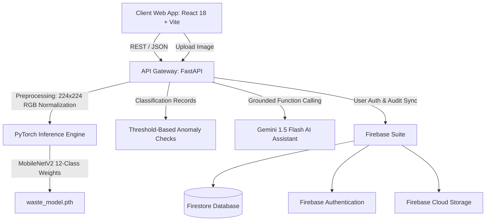

# RJ 147 — System Architecture & Design Specification

**Project Title:** RJ 147 — Smart Waste Segregation and Sanitation System  
**Application Name:** EcoSort AI  
**Tagline:** Smart Waste Segregation & Sanitation Intelligence  
**Project Classification:** Software-only Web Application (No Physical Hardware)  

---

## 1. High-Level Architecture Overview

EcoSort AI is designed as a decoupled, multi-tier software intelligence platform that combines transfer learning deep learning, unsupervised statistical anomaly detection, and controlled LLM reasoning.



---

## 2. Core Subsystems

### A. Frontend Layer (React 18 + Vite + Chart.js)
- **Role-Based Routing:** Dual operational consoles for standard researchers and administrators.
- **Visual Analytics:** Interactive Doughnut, Line, and Bar charts for real-time telemetry rendering.
- **Reactive Chat Interfaces:** 
  - `WasteAI` for user recycling queries.
  - `SanitationAI` for admin operations with grounded function-call execution traces.
- **Guaranteed Isolation:** Centralized mock fallback structures ensure non-disruptive offline usability.

### B. Machine Learning Inference Engine (MobileNetV2 Transfer Learning)
- **Framework:** PyTorch
- **Trained Model File:** `ml/model/waste_model.pth` (~9.8 MB)
- **Input Dimensions:** 224 × 224 RGB
- **Image Normalization:** ImageNet Mean `[0.485, 0.456, 0.406]`, Std `[0.229, 0.224, 0.225]`
- **Classification Head Structure:**
  ```python
  nn.Sequential(
      nn.Dropout(p=0.2),
      nn.Linear(1280, 128),
      nn.ReLU(),
      nn.Dropout(p=0.2),
      nn.Linear(128, 12)
  )
  ```
- **12 Classes:** `battery`, `biological`, `brown-glass`, `cardboard`, `clothes`, `green-glass`, `metal`, `paper`, `plastic`, `shoes`, `trash`, `white-glass`
- **Benchmark Performance:** 95.75% Test Accuracy, 95.73% Macro F1-score.

### C. Data-driven Sanitation Intelligence
- **Software-Only Operational Engine:** Operates strictly on computational event telemetry (frequency of intake, stream skews, class entropy, historical rate of variance).
- **Zero Sensor Dependence:** Strictly excludes physical hardware sensors (ultrasonic fill sensors, weight loadcells, smell/odour gas sensors, temperature sensors).
- **Status Classification:** Computes `GOOD`, `ATTENTION REQUIRED`, or `CRITICAL` based on clear mathematical threshold rules.

### D. Record-Based Anomaly Checks
- **Algorithm:** Deterministic thresholds over the latest 20 stored classification records, after a 10-event minimum.
- **Rules:** Flags a hazardous-stream share of at least 20%, or at least three sampled records with classifier confidence below 60%.
- **Limitations:** Does not use a trained anomaly model, physical sensors, location data, or event-rate measurements.

### E. AI Assistants (WasteAI & SanitationAI)
- **Backend Proxying:** API keys remain strictly hidden in backend `.env` configuration; never exposed to React clients.
- **SanitationAI Function Calling:** Grounded in real telemetry endpoints (`get_sanitation_status`, `get_anomalies`, `get_waste_distribution`) with strict anti-hallucination guardrails.
